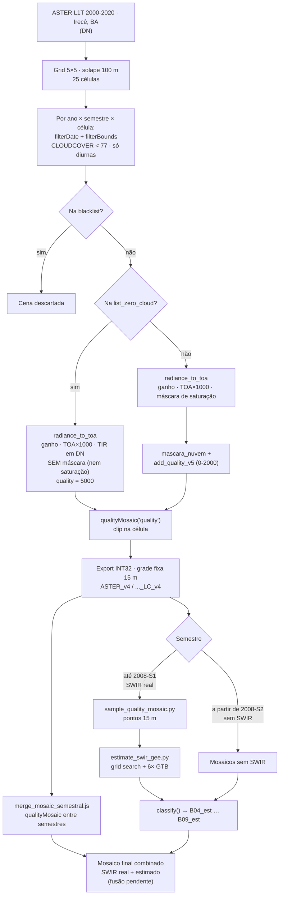

# Resumo da Metodologia — Mosaicos ASTER sem Nuvens (Irecê, BA)

> Projeto Prospectra 4.0 · Bloco Irecê (BA) · GEE: exportação pela
> `superconta` (projeto `mapbiomas-brazil`), assets auxiliares em
> `mapbiomas-arida`
>
> Este documento resume, em linguagem corrida, a metodologia empregada para
> construir os mosaicos multitemporais ASTER sem nuvens usados na
> prospecção mineral da área de Irecê, complementando o roteiro técnico já
> registrado em
> [`src/building_dataset/readme_notas.md`](src/building_dataset/readme_notas.md).
> As referências a scripts e funções apontam para os arquivos reais do
> repositório.
>
> **Versão do pipeline descrita: v4** (outubro/2026) — script Python único
> [`build_mosaicos_semestrais.py`](src/building_dataset/build_mosaicos_semestrais.py),
> exportação por célula de uma grid 5 × 5, reflectância em escala × 1000.
> A seção 11 registra o que mudou em relação às versões anteriores e por quê.

## 1. Introdução — Por que processamento em nuvem (cloud computing)

Antes de descrever a metodologia em si, vale situar a escolha de
plataforma: todo o pipeline deste documento — da leitura das cenas ASTER
brutas até a exportação dos mosaicos finais — roda inteiramente no
**Google Earth Engine (GEE)**, uma plataforma de processamento geoespacial
em nuvem. Essa escolha não é incidental: é o que torna o problema tratável
na escala em que ele existe.

O bloco de Irecê (`LIST_COORD`, de −44,46° a −39,20° de longitude e de
−14,79° a −9,42° de latitude) cobre um retângulo de aproximadamente
**570 km × 595 km** — da ordem de **340.000 km²**. Um único mosaico para
essa área, nas 16 bandas exportadas (VNIR 15 m + SWIR 30 m + TIR 90 m +
quality + saturado) a 15 m de resolução nominal, soma da ordem de
**1,5 bilhão de pixels por banda** — e o pipeline gera um mosaico desses
por semestre, ao longo de **21 anos** (2000–2020, 42 semestres). Somado às
milhares de cenas ASTER L1T brutas que cobrem o bloco no período (cada
cena cobre apenas ~60 × 60 km), o volume de dados que transita pelo
pipeline é da ordem de **terabytes**, não gigabytes.

Processar esse volume localmente — baixar cada cena L1T, reprojetar,
mascarar nuvem/sombra pixel a pixel, comparar `quality` entre centenas de
imagens e recompor o melhor pixel — exigiria armazenamento e poder de
processamento fora do alcance de uma estação de trabalho comum, além de
um tempo de processamento sequencial proibitivo. O GEE resolve isso de
duas formas complementares:

- **Os dados já estão na nuvem**: a coleção `ASTER/AST_L1T_003` já está
  ingerida e indexada no catálogo público do GEE — não é necessário
  baixar um único raster antes de processar.
- **O processamento é distribuído e paralelo**: cada operação pixel a
  pixel (`radiance_to_toa`, `mascara_nuvem`, `add_quality_v5`,
  `qualityMosaic`) é expressa de forma declarativa e executada pelos
  servidores do Google, que particionam área e bandas em tiles
  processados em paralelo.

Mesmo no GEE, exportar o bloco inteiro de uma vez por semestre mostrou-se
frágil (tasks longas e falhas). Por isso, a partir da v3 cada semestre é
exportado em **25 pedaços** — as células de uma grid 5 × 5 (seção 4.4).

## 2. Objetivo

Produzir um mosaico ASTER contínuo, de alta qualidade radiométrica e com o
mínimo de gaps espaciais/temporais, cobrindo o bloco de Irecê (BA), para
servir de insumo a análises de mapeamento geológico e prospecção mineral
(índices de argila, carbonato, óxidos de ferro etc.).

## 3. Decisões Críticas de Metodologia

Três decisões estruturam todo o restante da metodologia e precisam ser
justificadas antes de descrever o pipeline em si.

### 3.1 Por que ASTER, e não Landsat ou Sentinel-2?

Para prospecção mineral, o que importa não é a frequência temporal de
revisita (a litologia não muda de um ano para outro), e sim a **riqueza
espectral na região do SWIR**, onde ocorrem as feições de absorção que
distinguem os principais grupos de minerais de alteração:

| Sensor | Bandas totais | Bandas SWIR dedicadas | Cobertura 2.1–2.4 µm |
|---|---|---|---|
| **ASTER** | 14 (3 VNIR + 6 SWIR + 5 TIR) | **B04–B09** (6 bandas discretas, 30 m) | Resolvida em 6 bandas — separa argila (Al-OH), mica/AlMgOH, carbonato (CO₃) |
| Landsat 8/9 OLI/TIRS | 11 | 2 (SWIR1/SWIR2, largas) | 1 banda larga — sem resolução espectral para discriminar minerais de alteração |
| Sentinel-2 MSI | 13 | 2 (B11/B12, 20 m) | 1 banda larga, sem TIR |

O ASTER é o único sensor de acesso livre com bandas discretas o suficiente
no SWIR para calcular índices como **Al-OH (Caulinita)**, **Carbonato** e
**Ferric Iron** de forma diagnóstica (ver
[`bandas_ASTER.txt`](bandas_ASTER.txt) e a seção de índices em
`readme_notas.md`). Como a aplicação é geológica (não fenológica/agrícola),
a baixa frequência de revisita do ASTER é aceitável. O SWIR, porém, só
existe até **2008-S1**: a partir do 2º semestre de 2008 o detector SWIR
foi desligado, e na coleção do GEE as bandas B04–B09 vêm vazias e sem
`GAIN_COEFFICIENT` (seção 4.6).

### 3.2 Por que uma blacklist manual, além do filtro por metadado?

O pipeline filtra cenas por `CLOUDCOVER < 77` (metadado da coleção
`ASTER/AST_L1T_003`) antes de qualquer processamento. Mesmo assim, uma
lista de exclusão manual —
[`lista_imagens_Notaceites.txt`](src/building_dataset/lista_imagens_Notaceites.txt),
~2.900 IDs — é necessária porque **a máscara de nuvens/sombras
(`mascara_nuvem`) não é robusta o suficiente para remover 100% das nuvens
e sombras de toda cena**, sobretudo bordas de nuvem, névoa e sombras
projetadas em relevo mais acidentado. Cenas identificadas visualmente como
comprometidas (ver crítica em
[`aspectos_iniciais.txt`](src/building_dataset/aspectos_iniciais.txt))
são removidas por `system:index` antes de entrar no `qualityMosaic`.

O preço dessa decisão é cobertura: a blacklist remove cerca de **57% das
cenas diurnas**, e medições por semestre mostraram que ela é, junto com o
filtro de `CLOUDCOVER`, o principal motivo de mosaicos semestrais com
pouca área coberta (seção 9).

### 3.3 Por que uma lista separada de imagens sem nuvem (zero-cloud)?

Pelo motivo inverso: a máscara de nuvens/sombras também gera **falsos
positivos** — mascarando solo exposto muito claro/escuro, vegetação
escura ou corpos de água como se fossem nuvem/sombra. A lista
[`list_zero_cloud.txt`](src/building_dataset/list_zero_cloud.txt)
(324 cenas, organizada por semestre de 2000_1 a 2020_2) reúne cenas
**inspecionadas visualmente por um analista** e confirmadas sem nuvens
que atrapalhem. Essas cenas:

- entram no mosaico **intactas**: só passam pela conversão
  DN → radiância → TOA e pela mudança de escala; **nenhuma máscara** é
  aplicada — nem de nuvem/sombra, nem de saturação (a saturação fica
  registrada na banda `saturado`);
- recebem `quality = 5000` fixo, muito acima do teto das demais cenas
  (2000), e por isso **sempre vencem** a disputa pixel a pixel do
  `qualityMosaic`, tanto no mosaico semestral quanto no multitemporal.

As duas listas não se sobrepõem (conferido: 0 cenas em comum); se uma cena
aparecer nas duas, a blacklist vence.

## 4. Pipeline Completo

### 4.1 Seleção de cenas

Para cada ano/semestre — semestre 1 = `[ano-01-01, ano-07-01)`, semestre
2 = `[ano-07-01, (ano+1)-01-01)` — e para cada célula da grid:

1. `filterDate` do semestre + `filterBounds` da célula;
2. `CLOUDCOVER < 77`;
3. **só cenas diurnas** (`SOLAR_ELEVATION > 0` e com
   `GAIN_COEFFICIENT_B01`): cerca de 26% das cenas da coleção são
   noturnas e só têm TIR — sem VNIR, não servem ao mosaico;
4. exclusão da blacklist (só os IDs daquele semestre, para manter o grafo
   de cada task pequeno);
5. separação em dois ramos: cenas da lista zero-cloud e demais cenas.

### 4.2 Pré-processamento radiométrico

A coleção `ASTER/AST_L1T_003` do GEE está em **DN (números digitais)**,
não em radiância. A função `radiance_to_toa` faz:

1. **DN → radiância**: `L = (DN − 1) × GAIN_COEFFICIENT_Bxx`, com o
   coeficiente de ganho de cada banda lido dos metadados da cena;
2. **radiância → reflectância TOA**:
   `ρ = π · L · d² / (ESUN · cos θz)`, com a irradiância solar
   exoatmosférica por banda (`ESUN`), o ângulo zenital solar
   (`90° − SOLAR_ELEVATION`) e a distância Terra-Sol pelo dia do ano;
3. **escala × 1000**: a reflectância (0–1) é multiplicada por 1000
   (0–1000), ficando na mesma ordem de grandeza das bandas TIR, que
   **seguem em DN** (12 bits, ~1000–1500 na área);
4. **banda `saturado`** (0/1): marca pixels em que B01, B02 ou B3N atingem
   `DN ≥ 254` (VNIR de 8 bits; B01/B02 usam ganho alto e saturam sobre
   alvos claros, como afloramentos de calcário). Nas cenas comuns o pixel
   saturado é mascarado; nas cenas zero-cloud ele é mantido.

Cenas a partir de 2008-S2 não têm SWIR: as bandas B04–B09 saem
**totalmente mascaradas** (testado por `GAIN_COEFFICIENT_B04` ausente),
em vez de quebrar o cálculo.

### 4.3 Máscara de nuvens/sombras e camada de qualidade

Só para as cenas **fora** da lista zero-cloud. Todos os limiares estão na
escala × 1000 da reflectância TOA com ganho.

`mascara_nuvem`:

- **nuvem** = brilho visível médio (B01, B02, B3N) `> 190` **e** B10 mais
  fria que o percentil 20 da própria cena; a máscara passa por uma
  abertura morfológica (erosão + dilatação de 180 m) para remover ruído;
- **sombra** = pixel escuro (B01 `< 120` e B3N `< 170`) a até
  `2000 / tan(elevação solar) + 300 m` de uma nuvem (altura de nuvem
  assumida de 2000 m);
- **pixel válido** = VNIR > 0 e, quando a cena tem SWIR, B04 > 0.

`add_quality_v5` — score contínuo por pixel:

- 45% temperatura (B10 em DN, `unitScale(1050, 1300)`);
- 25% brilho VNIR (sobe de 53 a 122 e cai de 168 a 320, penalizando
  pixels escuros demais e claros demais);
- 15% SAVI e 15% NDWI invertido;
- bônus por `CLOUDCOVER` baixo (até +0,8) e bônus extra para
  `CLOUDCOVER = 0` (+0,3);
- resultado × 1000, limitado a **2000**.

`add_quality_zero_cloud` — cenas da lista zero-cloud: `quality = 5000`
em todo pixel com dado.

### 4.4 Mosaico semestral por célula da grid

A área é dividida numa **grid 5 × 5**
([`grid_irece_5x5.js`](src/building_dataset/grid_irece_5x5.js), asset
`projects/mapbiomas-arida/mine/grid_irece_5x5_solape100`): 25 células de
~1,05° × 1,07° (~115 × 119 km), numeradas `id` 1–25 (linha 1 = norte,
coluna 1 = oeste) e nomeadas `L<linha>C<coluna>`. As bordas internas têm
**sobreposição de 100 m** com as vizinhas.

Para cada ano × semestre × célula, os dois ramos são mesclados e
reduzidos com `qualityMosaic('quality')` — o GEE escolhe, pixel a pixel,
a observação de maior `quality` do semestre — e recortados pela célula.
O resultado é exportado em **INT32** como
`ASTER_QualityMosaic_<ano>_semestre_<N>_L<l>C<c>_v4` na coleção
`.../SAMPLES/CAATINGA/ASTER_v4` (projeto `mapbiomas-brazil`).

Todas as células saem na **mesma grade de pixels**: `crs EPSG:4326` e
`crsTransform` ancorado no canto noroeste do bloco, com pixel de 15 m
(≈ 0,0001347°). Assim as células encaixam pixel a pixel, e a faixa de
sobreposição tem valores idênticos nas duas células vizinhas.

Cada asset carrega as propriedades `year`, `semestre`, `celula_id`,
`celula_nome`, `num_images`, `num_zero_cloud`, `versao` e
`SCALE_FACTORS` (valor no asset = valor físico × fator: 1000 para
reflectância e quality, 1 para TIR e `saturado`).

Operação do script: ele pergunta anos, semestres, células, modo
(contagem de cenas ou exportação) e o máximo de tasks por execução; lista
o que já está salvo no destino e as tasks em andamento; e só exporta o que
falta. Células sem nenhuma cena no semestre não geram task. Cada execução
grava um `registro_mosaicos_v4_<data>.csv` com as contagens de cenas por
célula.

### 4.5 Mosaico final multitemporal

[`merge_mosaic_semestral.js`](src/building_dataset/merge_mosaic_semestral.js)
aplica o mesmo princípio um nível acima: a coleção de mosaicos
semestrais é reduzida outra vez com `qualityMosaic('quality')`,
produzindo um único mosaico multitemporal — `MOSAICO_FINAL_ASTER_IRECE` —
com o melhor semestre disponível em cada pixel. Como as cenas zero-cloud
têm `quality = 5000`, os pixels delas sobrevivem também nesse mosaico
final. **Pendente:** o script ainda lê as coleções antigas
(`mosaic_aster` / `mosaic_aster_p2008`) e precisa ser apontado para a
coleção `ASTER_v4` (as células são juntadas por `filter` + `qualityMosaic`).

### 4.6 O problema do SWIR ausente a partir de 2008-S2

Na v4 o mesmo pipeline cobre **2000–2020** numa só coleção. Nos
semestres até 2008-S1 as bandas B04–B09 são medidas pelo sensor; a partir
de 2008-S2 elas existem no asset, mas totalmente mascaradas. A camada de
quality usa só VNIR + TIR justamente para funcionar igual nos dois
períodos.

### 4.7 Amostragem de treino

Para recuperar o SWIR depois de 2008 é preciso um modelo treinado onde o
SWIR real existe. O script
[`sample_quality_mosaic.py`](src/building_dataset/sample_quality_mosaic.py)
extrai **30 000 pontos aleatórios** por mosaico semestral, direto na grade
de 15 m do asset (sem reamostragem: o export já gravou SWIR 30 m e TIR 90 m
em 15 m por vizinho mais próximo), com todas as bandas mais `quality`, e
exporta CSV/asset. O conjunto de treino é
`features = [B01, B02, B3N, B10–B14] → targets = [B04–B09]`, usando os
semestres até 2008-S1. **Pendente:** apontar o script para a coleção
`ASTER_v4` e variar a semente por semestre.

### 4.8 Modelagem — Gradient Tree Boosting (GTB) para estimar o SWIR

Dois caminhos de modelagem (ver seção 7):

- **GEE-side** — [`estimate_swir_gee.py`](src/modeling/estimate_swir_gee.py)
  (mirror em `estimate_swir_gee.ipynb`): treina
  `ee.Classifier.smileGradientTreeBoost` no servidor, um modelo por banda
  SWIR. É o caminho **operacional**, porque aplica o modelo sobre a imagem
  inteira sem exportar pixels.
- **Local** — [`train_swir_models.py`](src/modeling/train_swir_models.py)
  (e `.ipynb`): treina PLS, XGBoost e GPR com scikit-learn sobre os CSVs
  de `src/Dados/ASTER_Samples/` (com seleção de quais CSVs usar e
  diagnóstico de saturação), como **benchmark** do GTB.

### 4.9 Estimação final e mosaico combinado

Os 6 modelos GTB são aplicados sobre as bandas VNIR+TIR dos mosaicos sem
SWIR (`img_features.classify(...)`), gerando `B04_est`…`B09_est`. A
intenção final é combinar SWIR **real** (até 2008-S1) e SWIR **estimado**
(depois) num único mosaico contínuo, priorizando o real onde existir. O
script `estimate_swir_gee.py` já exporta o estimado
(`projects/mapbiomas-arida/mine/swir_estimated`); a **fusão** final ainda
não existe como script comitado.

## 5. Scripts e Funções por Etapa

| Etapa | Script | Função(ões) principais | Papel |
|---|---|---|---|
| Grid de exportação | `grid_irece_5x5.js` | — | 25 células com sobreposição de 100 m → asset `grid_irece_5x5_solape100` |
| Seleção de cenas | `build_mosaicos_semestrais.py` | `montar_semestre`, `ler_ids`, `ids_do_semestre` | Semestre, célula, CC < 77, diurnas, blacklist, ramos zero-cloud |
| DN → TOA | `build_mosaicos_semestrais.py` | `radiance_to_toa` | Ganho, TOA × 1000, banda `saturado`, SWIR ausente |
| Máscara nuvem/sombra | `build_mosaicos_semestrais.py` | `mascara_nuvem` | Nuvem (brilho + TIR frio) e sombra (escuro perto de nuvem) |
| Camada de qualidade | `build_mosaicos_semestrais.py` | `add_quality_v5`, `add_quality_zero_cloud` | Score 0–2000; zero-cloud = 5000 |
| Mosaico semestral | `build_mosaicos_semestrais.py` | `qualityMosaic('quality')`, `para_int32`, `executar` | Melhor pixel por célula; export INT32 em grade fixa |
| Inspeção dos mosaicos | `visualizar_mosaico_semestral.js` | — | Seletor de imagem, camadas, estatísticas, histogramas, perfil espectral |
| Mosaico final | `merge_mosaic_semestral.js` | `qualityMosaic('quality')` | Consolida semestres em `MOSAICO_FINAL_ASTER_IRECE` (a adaptar à v4) |
| Amostragem de treino | `sample_quality_mosaic.py` | `.sample()` | Pontos aleatórios a 15 m (a adaptar à v4) |
| Download dos pontos | `download_points_assets.py` / `.js` | — | Pontos do GEE → CSV local / Drive |
| Modelagem GTB (GEE) | `estimate_swir_gee.py` / `.ipynb` | `carregar_pontos`, `treinar_gbt`, `grid_search` | 6 `smileGradientTreeBoost` (1 por banda SWIR) |
| Aplicação/estimação | `estimate_swir_gee.py` / `.ipynb` | `img_features.classify(...)` | `B04_est`…`B09_est` sobre o mosaico sem SWIR |
| Benchmark local | `train_swir_models.py` / `.ipynb` | PLS / XGBoost / GPR | Validação do desempenho do GTB |
| Diagnósticos | `analise_todas_bandas.py`, `analise_histogramas_*`, `resumo_cenas_histograma.py` | — | Investigação das bandas e das cenas boas × ruins (seção 11) |

O script JS original
[`select_black_list_save_mosaicSem.js`](src/building_dataset/select_black_list_save_mosaicSem.js)
continua no repositório como referência para o Code Editor, mas o
caminho operacional é o Python.

## 6. Bandas Exportadas

| Banda | Sensor/Região | Comprimento de onda | Resolução nativa | Unidade no asset | Papel na metodologia |
|---|---|---|---|---|---|
| B01 | VNIR — Verde | 0.520–0.600 µm | 15 m | TOA × 1000 | RGB, brilho, quality, SAVI/NDWI |
| B02 | VNIR — Vermelho | 0.630–0.690 µm | 15 m | TOA × 1000 | RGB, Ferric_Fe, SAVI |
| B3N | VNIR — NIR | 0.780–0.860 µm | 15 m | TOA × 1000 | Brilho, SAVI, feature p/ GTB |
| B04 | SWIR1 | 1.600–1.700 µm | 30 m | TOA × 1000 | Alvo GTB (vazia a partir de 2008-S2) |
| B05 | SWIR2 (Al-OH) | 2.145–2.185 µm | 30 m | TOA × 1000 | Alvo GTB; AlOH_Clay |
| B06 | SWIR3 (referência) | 2.185–2.225 µm | 30 m | TOA × 1000 | Alvo GTB; denominador dos índices |
| B07 | SWIR4 (Al-Mg-OH) | 2.235–2.285 µm | 30 m | TOA × 1000 | Alvo GTB; AlOH_Clay |
| B08 | SWIR5 (CO₃) | 2.295–2.365 µm | 30 m | TOA × 1000 | Alvo GTB; Carbonate |
| B09 | SWIR6 | 2.360–2.430 µm | 30 m | TOA × 1000 | Alvo GTB |
| B10–B14 | TIR | 8.125–11.65 µm | 90 m | DN (12 bits) | Máscara de nuvem, quality, feature p/ GTB |
| quality | — | — | — | score × 1000 | 0–2000 cenas comuns; 5000 zero-cloud |
| saturado | — | — | — | 0/1 | VNIR com DN ≥ 254 (só aparece em cena zero-cloud) |

Para voltar ao valor físico: reflectância = valor / 1000; quality = valor
/ 1000. O TIR pode ser convertido em temperatura de brilho com os
coeficientes de conversão fixos do ASTER e as constantes de Planck (feito
no `visualizar_mosaico_semestral.js`).

## 7. O Algoritmo GTB (Gradient Tree Boosting) para Estimação do SWIR

O estimador usado é o **`ee.Classifier.smileGradientTreeBoost`** do GEE
(implementação da biblioteca SMILE), em modo `REGRESSION`, um modelo
independente por banda-alvo (6 modelos: B04…B09).

- **Entradas (features):** B01, B02, B3N (VNIR) + B10–B14 (TIR) — as
  únicas bandas disponíveis tanto no período com SWIR quanto no período
  sem SWIR.
- **Saída:** valor contínuo estimado da respectiva banda SWIR.
- **Por que boosting de árvores, e não regressão linear direta:** a
  relação entre VNIR/TIR e cada banda SWIR não é linear (superfícies
  minerais distintas produzem combinações VNIR/TIR parecidas com
  respostas SWIR bem diferentes); ensembles de árvores capturam essas
  interações sem exigir a escolha manual de termos de interação.
- **Hiperparâmetros ajustados por grid search** (`PARAM_GRID`):
  `numberOfTrees` (100–500), `shrinkage` (0.05–0.10), `samplingRate`
  (0.7–0.9) e `maxNodes` (64–256).
- **Validação:** split 80/20 via `randomColumn` (`seed=42`); cada
  combinação é avaliada pelo RMSE de validação; a melhor é re-treinada no
  conjunto completo antes de ser aplicada à imagem.
- **Filtro de qualidade dos pontos de treino:** só pontos com quality
  acima de um limiar entram no treino, para evitar nuvem/sombra residual.
  **Atenção:** o script usa `QUALITY_MIN = 5000`, pensado para a escala
  antiga (INT16, quality × 10000 → 0,5). Na escala v4 (quality × 1000),
  5000 selecionaria **só** pixels de cenas zero-cloud; o equivalente a
  0,5 é **500**. Ajustar ao migrar para a v4.
- **Aplicação:** `image.classify(classifier, '<banda>_est')` roda o
  modelo pixel a pixel no servidor GEE.

## 8. Fluxograma da Metodologia

## 9. Limitações Conhecidas

- **Cobertura semestral limitada pelos filtros de cena**: medições com o
  pipeline anterior (CC < 70) mostraram mosaicos semestrais cobrindo de
  ~4% (2004-S1) a ~69% (2010-S1) do bloco. Os maiores cortes vêm de
  filtros que excluem a cena inteira — `CLOUDCOVER` e blacklist —, não das
  máscaras de pixel (que custam de 1 a 3 pontos percentuais de área,
  porque outras cenas cobrem o buraco). Além disso, o ASTER é tomado sob
  demanda: em vários semestres só parte do bloco tem alguma cena. O
  mosaico multitemporal é o que fecha os buracos.
- **Blacklist montada antes da correção do ganho**: parte das cenas foi
  julgada pela cor falsa da época em que o DN era tratado como radiância
  (cor falsa avermelhada que, na verdade, era vegetação). Uma revisão da
  lista pode recuperar cenas boas.
- **Saturação do VNIR** (DN ≥ 254, ganho alto em B01/B02): nas cenas
  comuns, o pixel saturado é mascarado, o que tira justamente alvos claros
  (afloramentos e solos de calcário); nas zero-cloud ele é mantido, mas
  com valor cortado no teto — filtrar pela banda `saturado` em análises
  quantitativas.
- **Sem correção atmosférica**: os índices são calculados sobre
  reflectância TOA, não de superfície.
- **Deslocamento entre cenas (paralaxe)**: o L1T não é ortorretificado com
  precisão em relevo acidentado; cenas de datas diferentes podem ter
  deslocamentos de 30–50 m, que o `qualityMosaic` mitiga melhor que um
  `median`, mas não elimina.
- **Máscara de nuvem/sombra imperfeita** (motivo das decisões 3.2 e 3.3).
- **Normalização entre cenas** (histogram matching / z-score) não é
  aplicada: só seria válida sobre alvos pseudo-invariantes em área comum,
  e as cenas de um mesmo semestre em geral vêm de órbitas diferentes,
  sem área em comum (ver
  [`revisao_normalizacao.md`](src/building_dataset/revisao_normalizacao.md)).
- **SWIR estimado, não medido**, depois de 2008-S1 — carrega a incerteza
  do modelo GTB.

## 10. Referências

- ASTER L1T — NASA LP DAAC (coeficientes de ganho e conversão DN →
  radiância).
- Rowan, L.C.; Mars, J.C. (2003). *Lithologic mapping in the Mountain
  Pass, California area using ASTER data* — base do índice Al-OH.
- Google Earth Engine — documentação de `qualityMosaic` e
  `smileGradientTreeBoost`.
- Documentação interna: [`README.md`](README.md),
  [`src/building_dataset/readme_notas.md`](src/building_dataset/readme_notas.md),
  [`src/building_dataset/aspectos_iniciais.txt`](src/building_dataset/aspectos_iniciais.txt),
  [`src/building_dataset/revisao_normalizacao.md`](src/building_dataset/revisao_normalizacao.md).

## 11. Histórico de Correções do Pipeline

As versões anteriores (scripts JS `select_black_list_save_mosaicSem.js`,
coleções `mosaic_aster` e `mosaic_aster_p2008`) tinham problemas que
comprometiam os valores das bandas. Eles foram encontrados investigando
um erro nas bandas TIR (B10–B14) e comparando cenas "boas" e "ruins"
banda a banda (`analise_todas_bandas.py`, `analise_histogramas_*`).

| Problema | Efeito | Correção |
|---|---|---|
| Conversão para INT16 com fator 10000 em todas as bandas (`escala[b]` com chave do servidor sempre caía no padrão) | TIR (DN ~1000) × 10000 estourava o teto de 32767: B10–B14 inteiras cortadas | Fator buscado com `ee.Dictionary(escala).get(b)`; depois, export em INT32 |
| DN tratado como radiância (sem `GAIN_COEFFICIENT`) | SWIR inflado 14–31×, VNIR 1,2–1,5×; limiares de nuvem/quality descalibrados; cor falsa avermelhada | `L = (DN − 1) × ganho` antes do TOA; limiares reescalados |
| Saturação do VNIR ignorada | Pixels com DN 254–255 entravam como valores válidos | Banda `saturado`; máscara nas cenas comuns |
| Cenas noturnas na coleção (26%) | Sem VNIR nem ganho: erro "Image.constant: Parameter 'value' is required" | Filtro de cenas diurnas |
| SWIR desligado a partir de 2008-S2 | Sem `GAIN_COEFFICIENT_B04`: o mesmo erro | SWIR mascarado quando ausente |
| Export do bloco inteiro por semestre | Tasks longas e falhas | Export por célula da grid 5 × 5 (v3) |
| Escalas diferentes entre bandas (TOA 0–1 × TIR em DN) | Bandas em ordens de grandeza distintas | TOA × 1000 e quality × 1000 (v4) |
| `CLOUDCOVER < 70` | Cobertura semestral baixa | `CLOUDCOVER < 77` (v4) |
| Cenas zero-cloud ainda passavam pela máscara de saturação | Pixels de cenas inspecionadas perdidos | Zero-cloud intactas, quality 5000 (v4) |
